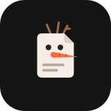
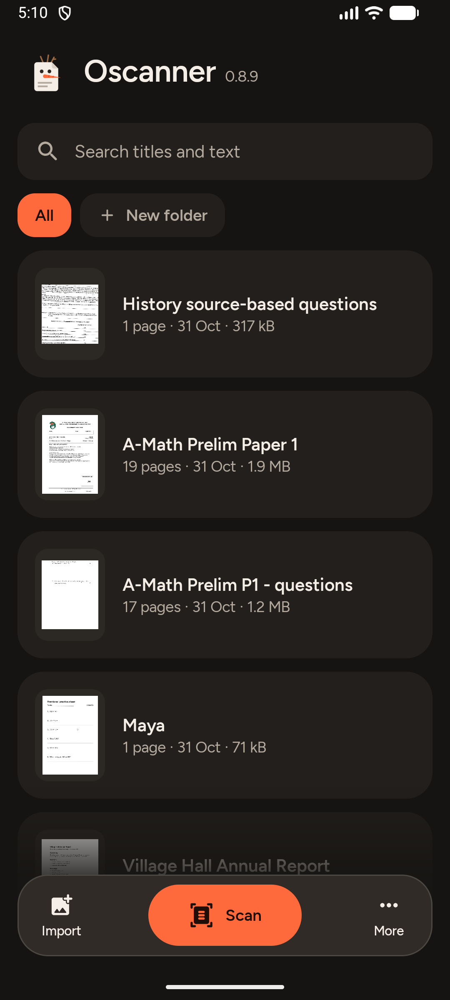
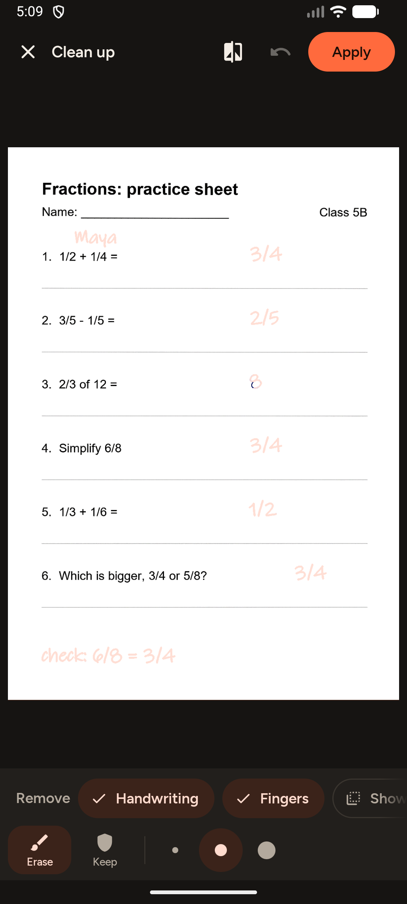
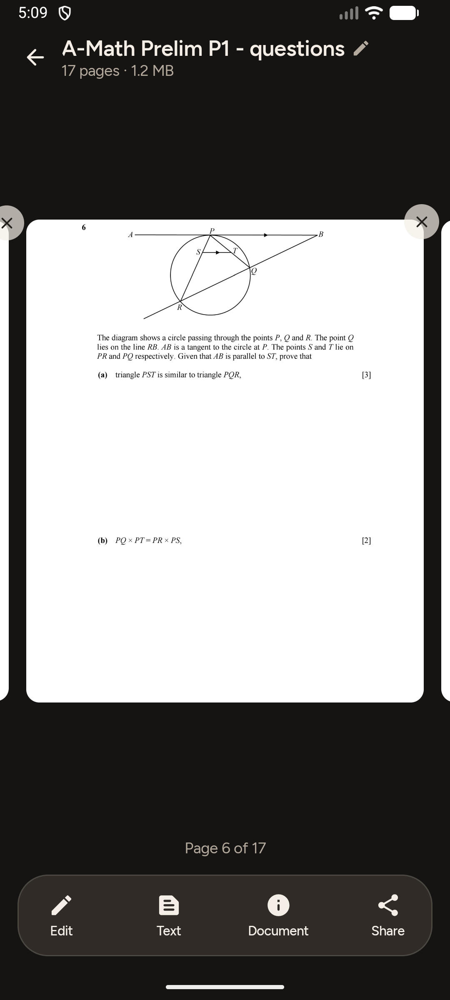
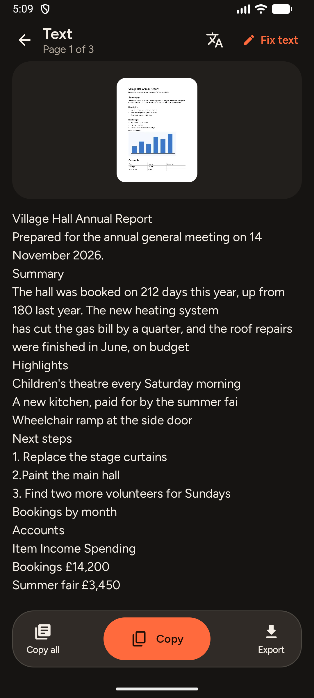
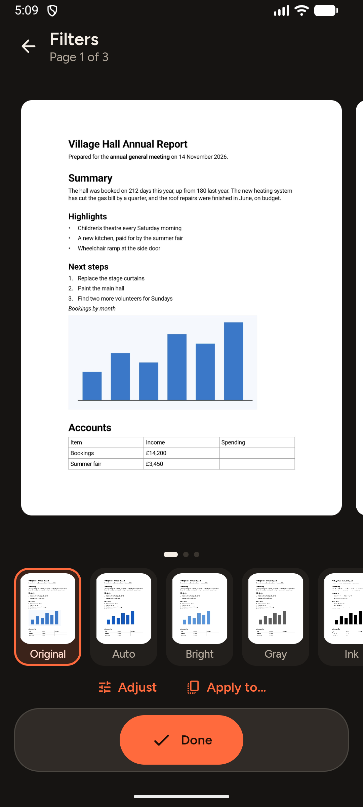

<p align="center">
  
</p>

<h1 align="center">Oscanner</h1>

<p align="center">
  A private document scanner for Android. Paper to clean, shareable PDFs in a few taps, with
  everything happening on the phone: no account, no ads, no tracking, no watermark of its own.
</p>

<p align="center">
  <a href="https://github.com/Dragjon/Oscanner/releases/latest"></a>
  <a href="https://github.com/Dragjon/Oscanner/releases"></a>
  <a href="LICENSE"></a>
  
  
  <br>
  
  
  
  
</p>

<p align="center">
  
  
  
  
  
</p>

Licensed under the GNU GPL v3. Third-party components are listed in
[`licenses/THIRD_PARTY.md`](licenses/THIRD_PARTY.md). Product goals live in
[`PRODUCT.md`](PRODUCT.md) and the full plan, including the clean-room rules every contributor
follows, in [`PLAN.md`](PLAN.md).

## What it does

- **Scan**: live page detection (with a small learned page finder for white pages on pale or busy
  surfaces) with auto-capture, a glare warning, batch scanning, crop with a
  magnifier, and the looks Original, Auto, Bright, Gray, Ink and Board, with shadow and grain
  removal and neutral paper under tinted light; old photos have fading, dust, scratches and torn corners mended. Curved pages are flattened, lines straightened and text squeezed toward a book's spine widened back out; photos of screens can
  have their moiré patterns reduced. Modes for ID cards (printed at true size), books (split at
  the spine), whiteboards, and QR codes or barcodes.
- **Text**: on-device OCR (PP-OCR models for English, with doubtful words corrected from word
  statistics; Tesseract for other languages), full-text search, searchable PDFs, copy, and export to
  plain text, a spreadsheet, or a Word file that keeps the page's headings, paragraphs and
  pictures; documents can also be shared as PowerPoint slides, and a portrait made into a
  passport or ID photo with a sheet of copies to print.
- **Translation on the phone**: Text → Translate puts a document's text into another of 58
  languages with Mozilla's Firefox Translations models (each language downloaded once, about
  20 to 70 MB); the text itself never leaves the phone. The page's picture shows the
  translation in place of its own words, in the same layout, to read full screen or share,
  and a translation is kept with the document to show again next time.
- **Documents**: named for what they are once read ("Receipt – Greenleaf Market – 18 Oct 2026",
  "Letter from Riverside Council – 7 Oct 2026"), folders (renamed or deleted with a long press;
  All groups documents by folder), tags and notes, Trash, merge, reorder/rotate/copy out pages, sign,
  draw, type text and stamps, erase, remove handwriting (found pixel by pixel by a small on-device
  network) or fingers, black out private details (found automatically or by hand, and removed
  from the text layer too), password-protected PDFs (AES-256), page and file size options,
  watermark, App lock. Edits can be applied to other pages at once. Test papers: split into
  one question a page, mark the ones answered wrong and gather them to practise again.
- **PDFs and Office files you already have**: import a PDF, Word document, Excel workbook or
  PowerPoint deck (or open or share one to Oscanner) and its pages become a document to sign,
  mark up, black out, clean and merge like a scan. An Office file's text is kept exactly, and a
  PDF's too on Android 15 and later, instead of being read again.
- **Everywhere**: share sheet in and out as PDF, a smaller PDF, separate pictures or one long
  picture; save to any file provider, print, a Scan shortcut, Quick Settings tile and widget.
  Send to a computer on the same Wi-Fi: it downloads the PDF in a browser, no account or cable.
- **Your defaults from the start**: after the welcome tour, four short steps set the theme, the
  look and fixes for new scans, which way up pages are taken, PDF page size, file size and
  watermark, reading text, the app lock and library order. Settings → Set up defaults runs it again.

What's next, measured against CamScanner, is in [`ROADMAP.md`](ROADMAP.md).

## Install

Download the APK for your phone from the [latest release](https://github.com/Dragjon/Oscanner/releases/latest)
(`arm64-v8a` for almost every phone from the last few years) and open it to install.

## Building

Requirements: Android Studio (or its bundled JDK 17+) and the Android SDK with platform 36.

```sh
./gradlew assembleDebug        # app/build/outputs/apk/debug/
./gradlew testDebugUnitTest    # unit tests
./gradlew assembleRelease      # per-ABI release APKs (unsigned)
```

Release builds are split per CPU type; the arm64 APK is about 18 MB.

## Project layout

```
app/              navigation, theme host, app lock, shortcut/tile/widget
core/model        plain data types (documents, pages, edit recipes)
core/data         Room database, page files, rendering queue, OCR jobs, export
core/imaging      OpenCV: detection, straightening, looks, clean-up, book split
core/ocr          PP-OCR reader and word fixer, Tesseract wrapper, language downloads
core/pdf          dependency-free PDF writer (text layer, AES-256) and DOCX writer
core/design       Soft Card, Night design system: theme, type, components
core/translate    on-device translation: Mozilla's bergamot engine (WebAssembly) in a hidden WebView
feature/*         library, capture, review, document, text, settings
```

Pages are never destroyed: each page keeps its original photo plus an edit recipe (crop,
look, sliders, marks, clean-up), and what you see is a render that can always be rebuilt.

## Not done yet

- Model-based filling of removed marks (LaMa inpainting)
- App-level encryption at rest (Android's file-based encryption protects data meanwhile)
- Source builds of OpenCV, Tesseract and ONNX Runtime for F-Droid; a baseline profile for faster cold start
- A freedom-to-operate review of the areas flagged ⚠ in `PLAN.md` before any public release
